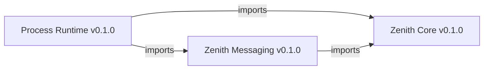

# Process Runtime ontology

The Runtime-owned module in this branch is proposed version 0.1.0.
It imports normalized Zenith 0.1.0 Core and Messaging at upstream commit
`4a5e54d744c0b1ed0e4dc5750ad98eb52dd11bc2`.

The module lives in
[src/process_runtime/ontology_resources/ontology.jsonld](../src/process_runtime/ontology_resources/ontology.jsonld).
Its `runtime:` namespace is
`https://zenith-research.ca/ontology/process-runtime/terms/`.
This replaces the provisional review prefix
`urn:zenith:process-runtime:ontology:review#` for the proposed application vocabulary.

## Imports and inheritance



| Runtime class | Complete inheritance path |
| --- | --- |
| ProcessDefinition | owl:Thing → zn:Artifact → runtime:ProcessDefinition |
| ProcessVersion | owl:Thing → zn:Artifact → runtime:ProcessVersion |
| ActorRegistration | owl:Thing → zn:Artifact → runtime:ActorRegistration |
| OutputCommit | owl:Thing → zn:Artifact → runtime:OutputCommit |
| Receipt | owl:Thing → zn:Artifact → zn:Receipt → runtime:Receipt |
| Event | owl:Thing → zn:Event → runtime:Event |
| ProcessRun | owl:Thing → runtime:ProcessRun |
| StepRun | owl:Thing → runtime:StepRun |
| Attempt | owl:Thing → runtime:Attempt |
| Lease | owl:Thing → runtime:Lease |
| RuntimeEffect | owl:Thing → runtime:RuntimeEffect |

ProcessDefinition denotes the editable, machine-readable authoring definition.
ProcessVersion denotes an independently identified immutable published snapshot.
`runtime:versionOf` links the snapshot to its definition.
`runtime:executesVersion` links a run to the exact version selected by its full
ProcessPin. The application mapping records the source and target pin fields.

ActorRegistration denotes the registration information record. Its verified
subject and optional directory_ref are separate bindings. An Entity reference
requires explicit identity resolution.

Receipt denotes the retained report of one terminal Attempt outcome. Its current
wire contract is unsigned and binds the pin, actor, fence, timestamps and digests.

Event denotes an occurrence. The `runtime.event.v1` envelope describes that
occurrence. Sequence, kind, recorded_at_ms and summary remain envelope fields.
Recording time records when the envelope was written.

## Shared reuse and application schemas

| Runtime term | Reviewed representation |
| --- | --- |
| Artifact | Reuse zn:Artifact for the identified retained content. Runtime metadata describes it. |
| RuntimeInbox | Reuse zn:Inbox → zn:Collection → owl:Thing for the logical collection. Stored rows are entries. |
| RuntimeOutbox | Reuse zn:Outbox → zn:Collection → owl:Thing for the logical collection. Wake-up rows are entries. |
| CompiledProcess | Compiled representation retained by ProcessVersion. |
| Actor | Capability/resource value used in scheduling. |
| ProcessPin | Typed reference to an exact ProcessVersion. |
| ArtifactRef | Typed reference to retained content. |
| AttemptSpan | Derived view of an existing Attempt and its terminal receipt. |

The [application mappings](../src/process_runtime/ontology_resources/mappings.json)
account for every Runtime term in contracts/ownership-v1.json and every persisted
RecordKind. They retain the current source field names and refer to the SDK's
existing `urn:zenith:process-runtime:v1` schema definitions.

The Process Runtime domain is an identified zn:Domain. Its qualified key is
`runtime/process-runtime`, its sourceModuleRef identifies the versioned module,
and its vocabularyRef identifies this Runtime-owned vocabulary.
The domain profile validates against the adopted Zenith Domain schema.

## Offline use and integrity

```sh
python -I -m process_runtime.ontology --format sources-v1
```

```python
from process_runtime.ontology import ontology_document, ontology_sources, schema_mappings

sources = ontology_sources()
assert sources["closureVerified"]
module = ontology_document()
mappings = schema_mappings()
```

The inspector works from an installed Runtime wheel in an empty working directory.
It verifies the packaged file hashes, upstream manifest and canonical bundle
digest, exact imported module closure, class inventory and full inheritance paths.

Every selected Zenith file is copied byte-for-byte from the verified v0.1.0 release
archive. Inline JSON-LD contexts and the packaged import resolver support offline
inspection. Version and term IRIs are logical identifiers resolved from these
resources.

## Compatibility and implementation

Adoption is additive ontology metadata. Historical records map through the current
RecordKind keys and v1 wire schema identifiers. Runtime owns the execution lifecycle,
typed compilation, lease/fence logic, persisted evidence and authority policy.

The compatibility gate checks generated provider and SDK contracts and runs the
full source suite. The candidate-wheel gate builds reproducibly, verifies installed
import origins and runs the ontology tests against the installed resources.

## Release follow-up

After review and merge, publish the Runtime ontology module and component artifact,
then repin any Lightweight Hub profile that selects the new Runtime package.
Keep the immutable module identity and exact adopted Zenith dependency in that
release's provenance. SAI's domain records remain owned by SAI's own vocabulary.
